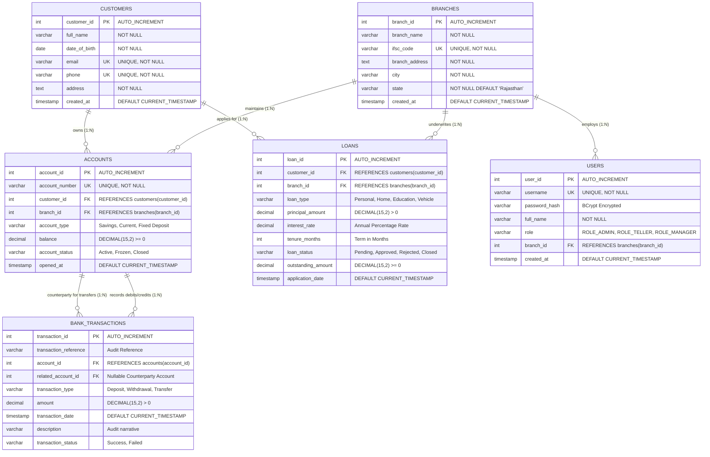

# Entity-Relationship (ER) Diagram — Bank of Bagru

The following diagram illustrates the relational database design for **Bank of Bagru** (`bank_of_bagru_db`) with table relationships, primary keys, and foreign keys.

---

## Cardinality Summary

1. **Customers &rarr; Accounts (1:N):**
   - Minimum: 0 (A newly registered customer may not yet have opened an account)
   - Maximum: $N$ (A customer can have multiple savings, current, and term deposit accounts)
2. **Branches &rarr; Accounts (1:N):**
   - Minimum: 0
   - Maximum: $N$ (A physical branch maintains multiple accounts)
3. **Customers &rarr; Loans (1:N):**
   - A customer can have zero or multiple loan facilities.
4. **Accounts &rarr; Bank Transactions (1:N):**
   - Every deposit, withdrawal, or transfer produces an entry in `bank_transactions`.
5. **Transfers (Self-Referential Association):**
   - During a fund transfer, two ledger records share the same `transaction_reference`:
     - Sending account entry (`account_id` = Sender, `related_account_id` = Recipient)
     - Receiving account entry (`account_id` = Recipient, `related_account_id` = Sender)
